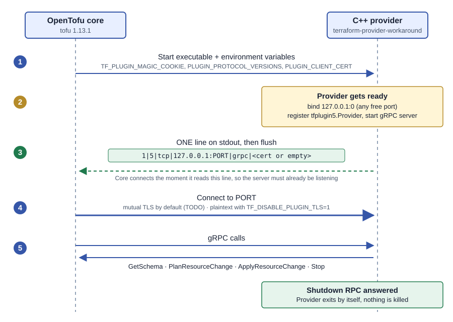

# Writing an OpenTofu provider in C++

Hand-off notes and a progress log. Last updated 2026-10-22.

**To resume with Claude:** open Claude in `~/wpe` and run `claude --resume tofu-provider-cpp-handshake`
(see section 0 for the one-time rename and for restoring on another machine), or just say
`resume from ~/claude-sessions/tofu-provider-cpp/tofu-provider-cpp-handshake/tofu-provider-cpp-handshake.md`.

## 0. What is in this folder (backup bundle)

This folder is **self-contained** for the topic "C++ OpenTofu provider: handshake, plaintext gRPC and
graceful shutdown". Scope: the provider runtime protocol only. VS Code / IDE setup is a separate
topic (`../tofu-plugin-ide-config/`) and is not duplicated here.

```
tofu-provider-cpp-handshake/
├── tofu-provider-cpp-handshake.md        this document (main hand-off)
├── 01-graceful-shutdown.md (+ .svg)      sub-document: the Shutdown RPC fix
├── tofu-provider-cpp-handshake-sequence.svg, tofu-provider-cpp-full-startup-sequence.svg
├── provider-source/                      snapshot of ~/tpc (commit 5de642b)
│   ├── CMakeLists.txt  cmake/common.cmake  .gitignore
│   ├── proto/tfplugin5.proto  proto/grpc_controller.proto
│   └── src/tofu-plugin.cpp
├── test-config/                          what OpenTofu is run with
│   ├── tofu.tf  example.tf               copy to ~/wpe/
│   └── tofurc                            copy to ~/.tofurc (dev_overrides; edit the path if not /home/prasad)
├── research-notes/                       copy of ~/wpe/ai/startup-handshake-docs/ (section 9)
└── session-history/
    └── d4e7212d-7c5e-47d3-9bc8-6c898f95e79c.jsonl   raw Claude transcript (private)
```

### Restore on a new machine
```bash
B=~/claude-sessions/tofu-provider-cpp/tofu-provider-cpp-handshake
mkdir -p ~/tpc ~/wpe
cp -r $B/provider-source/. ~/tpc/                 # provider source
cp $B/test-config/tofu.tf $B/test-config/example.tf ~/wpe/
cp $B/test-config/tofurc ~/.tofurc                # then fix the dev_overrides path to ~/tpc/build
mkdir -p ~/wpe/ai && cp -r $B/research-notes ~/wpe/ai/startup-handshake-docs
# build: needs cmake, g++, gRPC+protobuf+abseil in ~/.local/grpc, and OpenTofu 1.13.1 (see section 5)
cd ~/tpc && cmake -S . -B build -DCMAKE_PREFIX_PATH=$HOME/.local/grpc && make -C build
```
IDE setup for building and debugging in VS Code is in `../tofu-plugin-ide-config/`.

### Resume the Claude session (`claude --resume tofu-provider-cpp-handshake`)
This topic's original session is stored under the **`~/wpe`** project (its current name is
`tofu-cpp-provider`, not the name you asked for). Claude cannot rename it for you. Once:
```bash
cd ~/wpe && claude --resume tofu-cpp-provider      # then type:  /rename tofu-provider-cpp-handshake
```
After that, from `~/wpe`: `claude --resume tofu-provider-cpp-handshake`. Sessions are per folder, so
run it from `~/wpe`, not `~/tpc`. On a new machine, restore the transcript first:
```bash
mkdir -p ~/.claude/projects/-home-<user>-wpe
cp $B/session-history/*.jsonl ~/.claude/projects/-home-<user>-wpe/
```
(the folder name is the project path with `/` replaced by `-`). If it does not show up, this document
carries the same state.

## 1. Where things stand

Almost every OpenTofu/Terraform provider is written in Go, using HashiCorp's `terraform-plugin-*` libraries. Those libraries hide the protocol. This project writes a provider in **C++**, so everything the Go libraries do for free has to be done by hand.

| Area | Status |
| --- | --- |
| OpenTofu finds and launches the C++ binary | Works |
| Handshake line on stdout | Works |
| gRPC service `tfplugin5.Provider` (schema, plan, apply, destroy) | Works, minimal |
| `tofu plan`, `apply` and `destroy` with `TF_DISABLE_PLUGIN_TLS=1` | Works |
| Clean exit: OpenTofu's `Shutdown` call is answered and the provider exits by itself (no more `[ERROR] signal: killed`) | Works, see [01-graceful-shutdown.md](01-graceful-shutdown.md) |
| **mTLS, so it runs without `TF_DISABLE_PLUGIN_TLS=1`** | **Next task, not started** |
| Real provider logic (attributes, real resources) | Not started |

The provider currently has one resource, `workaround_example`, with no attributes. It proves the plumbing, and it does nothing useful yet.

## 2. How a provider works (the mental model)

A provider is a **separate program** that OpenTofu starts as a child process. They talk over **gRPC**. The Go library `go-plugin` defines how the two find each other, and a C++ provider has to copy that behaviour exactly.



The numbers match the diagram: (1) Core starts the binary, (2) the provider binds a port and starts its gRPC server, (3) it prints the handshake line, (4) Core connects, (5) provider RPCs. Shutdown now works too: Core calls `Shutdown` and the provider exits by itself, explained in [01-graceful-shutdown.md](01-graceful-shutdown.md). The diagram's last box shows that.

The full flow, with the cookie and version checks, mutual TLS, the supporting streams and shutdown, is below. It is a copy of `startup-sequence.svg` from the research notes in `~/wpe/ai/startup-handshake-docs/` (section 9); it is a snapshot and will not update if that original changes.


Key facts, learned the hard way:

- **The handshake is not just a port number.** It is one line with six fields separated by `|`:

  | Field | Meaning | Ours |
  | --- | --- | --- |
  | 1 | go-plugin core protocol version | `1` |
  | 2 | provider protocol major version | `5` |
  | 3 | network | `tcp` |
  | 4 | address, with no URL scheme | `127.0.0.1:<port>` |
  | 5 | transport | `grpc` |
  | 6 | server certificate: base64 of the DER bytes with the `=` padding removed. Empty means plaintext. | empty for now |

- **Print the line only after the server is already listening.** OpenTofu connects the moment it reads the line. Printing first caused `connection refused`, which was the first bug we hit.
- **Flush stdout, and keep it clean.** The handshake must be the first line on stdout. Send logs to stderr.
- **The port can be anything.** Bind to `127.0.0.1:0`, ask gRPC which port it got, and print that.
- **Core sets environment variables for you:**
  - `TF_PLUGIN_MAGIC_COOKIE` (value `d602bf8f470bc67ca7faa0386276bbdd4330efaf76d1a219cb4d6991ca9872b2`)
  - `PLUGIN_PROTOCOL_VERSIONS`
  - `PLUGIN_MIN_PORT` and `PLUGIN_MAX_PORT`
  - `PLUGIN_CLIENT_CERT`, which is present when mTLS is on
- **mTLS is on by default.** OpenTofu expects the provider to present a self-signed certificate and to require OpenTofu's client certificate. `TF_DISABLE_PLUGIN_TLS=1` turns this off for development.
- **Protocol 5 vs 6.** OpenTofu 1.13.1 offers both. We picked 5, using `tfplugin5.10.proto` from the OpenTofu repo. Protocol 6 uses `tfplugin6.proto` and was not tried; it has different method names (for example `GetProviderSchema` instead of `GetSchema`).

The detailed write-up from the earlier research is listed in section 9.

## 3. Why C++ is hard: the challenges

The Go SDK gives you `go-plugin`'s whole runtime for free. The research docs (section 9) put it this way: implementing only the provider service "does not reproduce the complete startup and lifecycle behavior of the Go SDK". In C++ you rebuild all of it from `.proto` files and documented behaviour.

1. **The startup protocol has no formal specification.** It is derived from reading go-plugin v1.8.0 and OpenTofu source, and defaults can change between go-plugin versions. Mistakes show up as vague errors: a banner on stdout, a missing flush, `6.10` instead of `6`, or a URI scheme in the address.
2. **Mutual TLS is the largest single piece (section 6).** Easy mistakes:
   - the incoming `PLUGIN_CLIENT_CERT` is PEM, but the outgoing field 6 is unpadded standard base64 of DER
   - the server certificate needs a `localhost` SAN even though you listen on `127.0.0.1`
   - you must require **and verify** the client certificate against the one Core supplied. Trusting the system CA store is not enough, and merely requesting a client certificate is not enough
   - choose credentials by whether `PLUGIN_CLIENT_CERT` is set. Only Core reads `TF_DISABLE_PLUGIN_TLS`
3. **Supporting services beyond the provider.** The Go server also registers `plugin.GRPCController`, `plugin.GRPCStdio`, `plugin.GRPCBroker` and the gRPC health service. You generate them from go-plugin's own `.proto` files. We now register the controller (fixing the `plugin failed to exit gracefully` kill, see [01-graceful-shutdown.md](01-graceful-shutdown.md)) but not the health, stdio or broker services. Core tolerates those being missing, but that is not full go-plugin compatibility.
4. **Long-lived streams and shutdown can deadlock.**
   - The broker and stdio streams stay open. If they use up your only worker threads, schema and shutdown calls cannot be served.
   - Calling a blocking `Shutdown()` from inside the `Shutdown` handler waits on itself. Schedule it outside the handler (done, see [01-graceful-shutdown.md](01-graceful-shutdown.md)).
   - Core only allows about 2 seconds for exit, so shutdown must be bounded.
   - Do not use stdin EOF as the signal, and note that the managed server ignores `SIGINT`.
5. **Two different "stop" mechanisms.** `Provider/Stop` (protocol 5) cancels in-flight operations. `GRPCController/Shutdown` ends the process. Implement both.
6. **Protocol and proto hygiene.**
   - Keep the `tfplugin5` package name exactly, or the gRPC method paths change and nothing interoperates.
   - Use one minor-version `.proto` per major version, taken from a release tag.
   - Set explicit gRPC message size limits. The Go SDK uses 256 MiB.
   - Our protoc and `grpc_cpp_plugin` disagreed on `GetMetadata.Request`; we commented that RPC out.
7. **Everything after the transport is a separate project.** Schema encoding, `DynamicValue` (msgpack), null and unknown values, diagnostics and resource lifecycle semantics are outside what the research docs cover. Our `0x80` empty object works only because the schema has no attributes.
8. **Testing traps.** `TF_REATTACH_PROVIDERS` is plaintext-only and skips the cookie, version selection, stdout framing and mTLS, so "works under reattach" proves little about the real launch path. A good minimal end-to-end check is `tofu providers schema -json`, which needs no resources.

### Our status against those challenges

| Challenge | Status |
| --- | --- |
| Handshake framing, flush and ordering | Done |
| Provider service (minimal) | Done |
| Plaintext mode | Done |
| mTLS | Not started (next, section 6) |
| Controller service (`Shutdown`), clean exit | Done ([01](01-graceful-shutdown.md)) |
| Health, stdio and broker services | Not done |
| Magic cookie check | Not done |
| `PLUGIN_PROTOCOL_VERSIONS` parsing (we hard-code `5`) | Not done |
| Port range (`PLUGIN_MIN_PORT`/`PLUGIN_MAX_PORT`) | Not honoured |
| Real msgpack, schema and diagnostics | Not done |
| Negative test suite | Not done |

## 4. The pieces of this project

**Test config, in `~/wpe`:**
- `tofu.tf` declares provider `workaround` from source `aptexan/workaround` version `0.0.1`, and one resource, `workaround_example.example`. It requires OpenTofu 1.13.1.

**OpenTofu CLI config, `~/.tofurc`:**
```hcl
provider_installation {
  dev_overrides {
    "aptexan/workaround" = "/home/prasad/tpc/build"
  }
  direct {}
}
```
- The value is a **directory** that contains the binary.
- OpenTofu reads `~/.tofurc`. It only falls back to `~/.terraformrc` when `~/.tofurc` doesn't exist.
- With `dev_overrides` you do **not** run `tofu init`, and the version in `tofu.tf` is ignored.
- The short source `aptexan/workaround` is fine. OpenTofu expands it to `registry.opentofu.org/aptexan/workaround`.
- `~/.terraform.d` is empty and not involved.

**The provider, in `~/tpc`:**
- The binary must be named `terraform-provider-<name>`. Ours is `terraform-provider-workaround`, built into `~/tpc/build/`.
- `proto/tfplugin5.proto` is OpenTofu's v1.13.1 protocol definition. One edit: `rpc GetMetadata` is commented out. protoc and `grpc_cpp_plugin` generate different C++ names for `GetMetadata.Request` (`GetMetadata__Request`), and the build failed on it. The RPC is optional.
- `proto/grpc_controller.proto` is go-plugin v1.8.0's controller service (the `Shutdown` RPC), unmodified.
- `CMakeLists.txt` generates C++ from those two protos and builds the executable. The original sample `tofu-plugin.proto` is deleted.
- `src/tofu-plugin.cpp` is the whole provider, about 190 lines:
  - `ProviderServiceImpl` implements `tfplugin5.Provider`.
  - `GetSchema` returns an empty provider block and an empty `workaround_example` block.
  - Plan and read echo the state they are given. Apply echoes the planned state, so a create gives an empty object and a destroy gives null. Getting the destroy case wrong made OpenTofu report "provider returned a non-null object" after a destroy.
  - `ControllerServiceImpl` answers Core's `Shutdown` call by stopping the gRPC server from a helper thread, so the process exits at once.
  - Everything else is a minimal stub or returns `UNIMPLEMENTED`.
  - `RunServer` binds, starts, then prints the handshake.

## 5. How to run it

```sh
cd ~/tpc/build && make                    # rebuild after code changes
export TF_DISABLE_PLUGIN_TLS=1            # plaintext, until mTLS exists
cd ~/wpe                                  # the directory with tofu.tf
tofu plan
tofu apply -auto-approve
tofu destroy -auto-approve
TF_LOG=DEBUG tofu plan                    # TRACE for more detail; shows launch and handshake
rm -f terraform.tfstate*                  # untracked, clean up afterwards
```

Don't run manual `cmake` in `~/tpc/build` with another compiler. Use `make` there.

## 6. Next: mTLS

Goal: `tofu plan` works **without** `TF_DISABLE_PLUGIN_TLS=1`.

1. When `PLUGIN_CLIENT_CERT` is set, generate a self-signed server certificate with OpenSSL. Keep the private key in memory. Use the same profile as the Go reference:
   - ECDSA, P-521 or P-256
   - a SAN of DNS `localhost`
   - key usage for client and server auth
   - CA flag set
   - key usages: digital signature, key encipherment, key agreement and cert signing
2. Start gRPC with `grpc::SslServerCredentials`:
   - set `pem_root_certs` to `PLUGIN_CLIENT_CERT`
   - require **and verify** the client certificate (`GRPC_SSL_REQUEST_AND_REQUIRE_CLIENT_CERTIFICATE_AND_VERIFY`)
   - supply the one key and cert pair
3. Put the base64 DER of the certificate, with no padding, into handshake field 6. OpenTofu checks it against the name `localhost`, with TLS 1.2 or later and HTTP/2.
4. Test with `unset TF_DISABLE_PLUGIN_TLS`. It was exported in the shell used so far.

## 7. After mTLS: remaining work, in suggested order

1. ~~Graceful shutdown~~ **Done** (2026-10-22): the `plugin.GRPCController` `Shutdown` RPC is implemented and the 2-second kill is gone. Details in [01-graceful-shutdown.md](01-graceful-shutdown.md). Still open from this item: the gRPC health service (service name `plugin`, status `SERVING`), which Core only uses for an explicit ping.
2. **Stdio and broker services.** Generate them from `grpc_stdio.proto` and `grpc_broker.proto`. An idle stream may just stay open, but it must be cancelled on shutdown and must not occupy the only worker.
3. **Startup checks.** Verify the magic cookie and exit 1 with a stderr message if it is wrong. Parse `PLUGIN_PROTOCOL_VERSIONS` instead of hard-coding `5`, and fail clearly when there is no overlap. Honour `PLUGIN_MIN_PORT` and `PLUGIN_MAX_PORT`.
4. **Real data.** Add a C++ msgpack library and implement `DynamicValue` encode and decode, schema attributes, and diagnostics. `PrepareProviderConfig`, `Configure` and `UpgradeResourceState` are stubs today.
5. **Test matrix.** Run `tofu providers schema -json` through the managed path, then cover:
   - protocol offers in both orders (`5,6` and `6,5`) and no common version
   - a missing or wrong cookie
   - TLS and plaintext
   - idle-stream shutdown
   - negative TLS checks: an unrelated or absent client certificate must be rejected

## 8. Gotchas

- **Don't run `find /` in this WSL.** It walks `/mnt/c` and hangs for minutes.
- `curl` to GitHub works. The proto was found by listing the repo with `api.github.com/repos/opentofu/opentofu/git/trees/v1.13.1?recursive=1`. The protocol files are in `docs/plugin-protocol/`.
- As of 2026-10-23 the `~/tpc` work is **committed** (latest `5de642b`, "Fixed the exit ERROR issue"), including both protos. An older note here said it was uncommitted; that is no longer true.
- Claude only commits when asked.

## 9. Reference material

One document per issue we fix, in this folder:

| File | Topic |
| --- | --- |
| [01-graceful-shutdown.md](01-graceful-shutdown.md) | Why OpenTofu killed the provider after each use (`[ERROR] … signal: killed`) and the `Shutdown` RPC that fixes it, with a gRPC and protobuf primer |


Research notes, copied into `research-notes/` in this folder (originals in `~/wpe/ai/startup-handshake-docs/`):

| File | Read it for |
| --- | --- |
| `README.md` | Scope: what is and is not covered |
| `startup-handshake.md` | The wire protocol: launch, environment, version selection, listener, mTLS (section 5), the stdout line (section 6), supporting services (section 7), shutdown (section 8) |
| `cpp-provider.md` | Implementation pseudocode, which `.proto` files to generate, the `dev_overrides` test recipe, `TF_REATTACH_PROVIDERS` debugging, and a symptom-by-stage troubleshooting table |
| `sources.md` | Exact upstream revisions and file locations behind each claim |
| `startup-sequence.svg` (source `.mmd`) | Sequence diagram of startup to shutdown |

These notes were written from source reading. They say themselves that their suggested checks were not executed as part of writing them.
